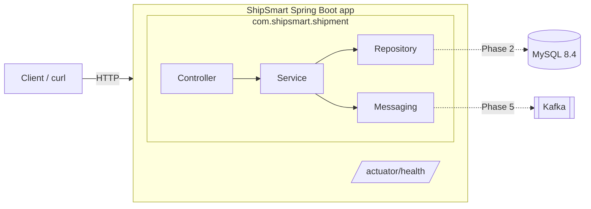

# ShipSmart Backend

Shipment management backend for the ShipSmart logistics platform, built with Java 17 and Spring Boot 3.

## What is ShipSmart?

ShipSmart is a logistics and shipment management platform for customers and operations teams. The goal is to let users create shipments, track them by tracking number, move them through delivery statuses with an audit history, and publish shipment events to Kafka for downstream services such as notifications. AI-assisted features are planned for later phases.

This repository is a learning project, built one phase at a time.

## What works today (Phase 1)

- A Spring Boot 3.5 application on Java 17 that starts with no database or message broker
- `GET /actuator/health`, plus Kubernetes-style `liveness` and `readiness` probes
- `GET /actuator/info` with app name and build details
- Only `health` and `info` are exposed; other Actuator endpoints return 404
- Environment-variable-driven configuration and an optional JSON logging profile
- Package skeleton for the shipment module (no shipment features yet)

**Not implemented yet:** shipment APIs, MySQL persistence, Kafka events, Docker Compose, authentication.

> **Status: Phase 1 — project skeleton and health endpoint.**
> There is no authentication yet. Do not deploy this for real users or real customer data until Spring Security is in place.

## Prerequisites

| Tool | Version | Check |
|---|---|---|
| JDK | 17 (Temurin recommended) | `java -version` |
| Maven | 3.9+ (or IntelliJ's bundled Maven) | `mvn -version` |
| IntelliJ IDEA | Community or Ultimate | — |

Install on macOS with Homebrew:

```bash
brew install --cask temurin@17
brew install maven
```

## Architecture

A **modular monolith**: one deployable application, with each business capability in its own package so it can later be pulled out into a separate service.



Package layout:

```
com.shipsmart
├── ShipSmartApplication          entry point; scanning starts here
└── shipment                      shipment module
    ├── config        Spring configuration (UTC Clock)
    ├── controller    HTTP layer
    ├── dto           request / response objects
    ├── entity        JPA entities
    ├── enums         ShipmentStatus etc.
    ├── exception     domain exceptions + global handler
    ├── mapper        entity <-> DTO
    ├── repository    Spring Data JPA
    ├── service       business logic, transactions
    ├── messaging     Kafka events
    └── validation    custom constraints, status transitions
```

### Time convention

All timestamps are stored and returned in **UTC** (ISO-8601, e.g. `2026-10-20T10:15:30Z`). Code gets the current time from the injected `java.time.Clock` bean, never from `Instant.now()` directly, so tests can pin time.

## Configuration

Every setting reads an environment variable with a local default. See `.env.example`.

| Variable | Default | Purpose |
|---|---|---|
| `SERVER_PORT` | `8080` | HTTP port |
| `SHIPSMART_LOG_LEVEL` | `DEBUG` | Log level for `com.shipsmart` |
| `SPRING_PROFILES_ACTIVE` | *(none)* | `json-logs` switches console logs to structured JSON |

Spring does not read `.env` files on its own. Either export the variables in your shell (`set -a; source .env; set +a`) or set them in IntelliJ's Run Configuration → *Environment variables*.

## Run

```bash
mvn spring-boot:run
```

or build a jar and run it:

```bash
mvn clean package
java -jar target/shipsmart-backend-0.1.0-SNAPSHOT.jar
```

## Check it works

```bash
curl -s http://localhost:8080/actuator/health
# {"status":"UP","groups":["liveness","readiness"]}

curl -s http://localhost:8080/actuator/health/liveness
# {"status":"UP"}

curl -s http://localhost:8080/actuator/info
# {"app":{"name":"ShipSmart",...},"build":{"version":"0.1.0-SNAPSHOT",...}}
```

Only `health` and `info` are exposed. Endpoints such as `/actuator/env` return 404 by design.

## Tests

```bash
mvn test
```

No database, Kafka or Docker needed for the test suite.

## Roadmap

1. ✅ Project skeleton, configuration, health endpoint
2. MySQL, Flyway migrations, entities, repositories, DTOs, mappers
3. REST endpoints, business logic, validation, status history, error handling
4. Unit and web-layer tests
5. Kafka event publishing
6. Docker Compose for MySQL and Kafka
7. Notification service extraction
