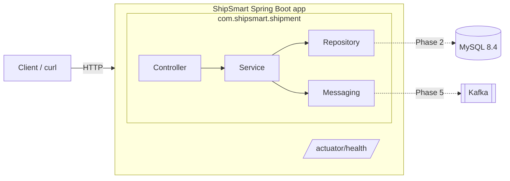
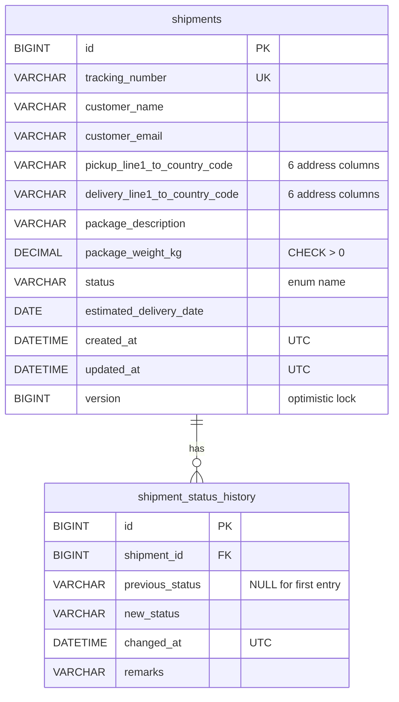

# ShipSmart Backend

Shipment management backend for the ShipSmart logistics platform, built with Java 17 and Spring Boot 3.

## What is ShipSmart?

ShipSmart is a logistics and shipment management platform for customers and operations teams. The goal is to let users create shipments, track them by tracking number, move them through delivery statuses with an audit history, and publish shipment events to Kafka for downstream services such as notifications. AI-assisted features are planned for later phases.

This repository is a learning project, built one phase at a time.

## What works today

**Phase 1 — foundation**
- A Spring Boot 3.5 application on Java 17
- `GET /actuator/health`, plus Kubernetes-style `liveness` and `readiness` probes
- `GET /actuator/info` with app name and build details
- Only `health` and `info` are exposed; other Actuator endpoints return 404
- Environment-variable-driven configuration and an optional JSON logging profile

**Phase 2 — persistence**
- MySQL 8.4 connection, configured through environment variables
- Versioned schema managed by Flyway (`shipments`, `shipment_status_history`)
- JPA entities, Spring Data repositories, request/response DTOs and a mapper
- Automatic UTC `createdAt`/`updatedAt` timestamps and optimistic locking

**Not implemented yet:** shipment REST endpoints and business rules (Phase 3), Kafka events, Docker Compose, authentication.

> **Status: Phase 2 — persistence layer. No shipment endpoints yet.**
> There is no authentication yet. Do not deploy this for real users or real customer data until Spring Security is in place.

## Prerequisites

| Tool | Version | Check |
|---|---|---|
| JDK | 17 (Temurin recommended) | `java -version` |
| Maven | 3.9+ (or IntelliJ's bundled Maven) | `mvn -version` |
| MySQL | 8.4 (local install or Docker) | `mysql --version` |
| Docker | Optional — only for the real-MySQL test | `docker info` |
| IntelliJ IDEA | Community or Ultimate | — |

Install on macOS with Homebrew:

```bash
brew install --cask temurin@17
brew install maven
```

## Architecture

A **modular monolith**: one deployable application, with each business capability in its own package so it can later be pulled out into a separate service.



Package layout:

```
com.shipsmart
├── ShipSmartApplication          entry point; scanning starts here
└── shipment                      shipment module
    ├── config        Spring configuration (UTC Clock)
    ├── controller    HTTP layer
    ├── dto           request / response objects
    ├── entity        JPA entities
    ├── enums         ShipmentStatus etc.
    ├── exception     domain exceptions + global handler
    ├── mapper        entity <-> DTO
    ├── repository    Spring Data JPA
    ├── service       business logic, transactions
    ├── messaging     Kafka events
    └── validation    custom constraints, status transitions
```

### Database schema

Flyway applies the scripts in `src/main/resources/db/migration` in version order at startup and records them in `flyway_schema_history`. Hibernate never changes the schema (`ddl-auto: validate`); it only checks that the entities match. A migration that has been applied must never be edited: change the schema with a new `V3__…sql` file.



Indexes: `(status, created_at)` and `(created_at)` on `shipments` for filtered and unfiltered listing; `(shipment_id, changed_at)` on history.

### Time convention

All timestamps are stored and returned in **UTC** (ISO-8601, e.g. `2026-10-20T10:15:30Z`). Code gets the current time from the injected `java.time.Clock` bean, never from `Instant.now()` directly, so tests can pin time.

## Configuration

Every setting reads an environment variable with a local default. See `.env.example`.

| Variable | Default | Purpose |
|---|---|---|
| `SERVER_PORT` | `8080` | HTTP port |
| `DB_URL` | `jdbc:mysql://localhost:3306/shipsmart?connectionTimeZone=UTC` | JDBC URL |
| `DB_USERNAME` | `shipsmart` | Database user |
| `DB_PASSWORD` | `shipsmart` | Database password — **local default only**; always set it outside your machine |
| `DB_POOL_SIZE` | `10` | Max DB connections |
| `SHIPSMART_LOG_LEVEL` | `DEBUG` | Log level for `com.shipsmart` |
| `SPRING_PROFILES_ACTIVE` | *(none)* | `json-logs` switches console logs to structured JSON |

Spring does not read `.env` files on its own. Either export the variables in your shell (`set -a; source .env; set +a`) or set them in IntelliJ's Run Configuration → *Environment variables*.

## Local MySQL setup

Pick one.

**Docker** (simplest; Docker Compose arrives in Phase 6):

```bash
docker run -d --name shipsmart-mysql -p 3306:3306 \
  -e MYSQL_ROOT_PASSWORD=root-local-only \
  -e MYSQL_DATABASE=shipsmart \
  -e MYSQL_USER=shipsmart -e MYSQL_PASSWORD=shipsmart \
  mysql:8.4
```

**Homebrew:**

```bash
brew install mysql@8.4
brew services start mysql@8.4
"$(brew --prefix mysql@8.4)/bin/mysql" -u root <<'SQL'
CREATE DATABASE IF NOT EXISTS shipsmart CHARACTER SET utf8mb4 COLLATE utf8mb4_0900_ai_ci;
CREATE USER IF NOT EXISTS 'shipsmart'@'localhost' IDENTIFIED BY 'shipsmart';
GRANT ALL PRIVILEGES ON shipsmart.* TO 'shipsmart'@'localhost';
SQL
```

The app user only needs rights on its own database. Tables are created by Flyway when the app first starts.

## Run

```bash
mvn spring-boot:run
```

or build a jar and run it:

```bash
mvn clean package
java -jar target/shipsmart-backend-0.1.0-SNAPSHOT.jar
```

## Check it works

```bash
curl -s http://localhost:8080/actuator/health
# {"status":"UP","groups":["liveness","readiness"]}

curl -s http://localhost:8080/actuator/health/liveness
# {"status":"UP"}

curl -s http://localhost:8080/actuator/info
# {"app":{"name":"ShipSmart",...},"build":{"version":"0.1.0-SNAPSHOT",...}}
```

Only `health` and `info` are exposed. Endpoints such as `/actuator/env` return 404 by design.

## Tests

```bash
mvn test                              # everything
mvn test -Dtest=ShipmentRepositoryTest  # one class
```

The suite uses an in-memory H2 database in MySQL mode (`src/test/resources/application-test.yml`), so it needs no MySQL or Docker. Flyway still runs the real migrations.

`MySqlSchemaTest` additionally runs the migrations against a real MySQL 8.4 container via Testcontainers. It runs when Docker is available and is **skipped** otherwise.

## Roadmap

1. ✅ Project skeleton, configuration, health endpoint
2. 🚧 MySQL, Flyway migrations, entities, repositories, DTOs, mappers
3. REST endpoints, business logic, validation, status history, error handling
4. Unit and web-layer tests
5. Kafka event publishing
6. Docker Compose for MySQL and Kafka
7. Notification service extraction
